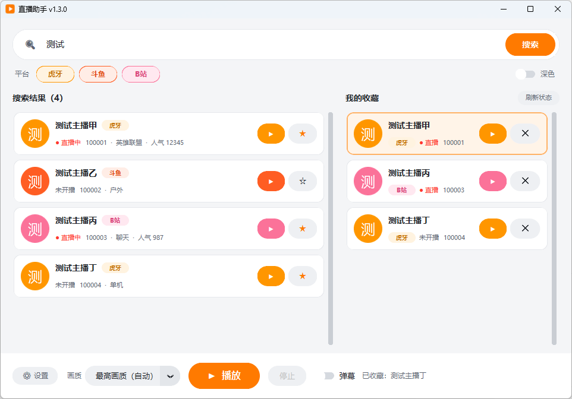
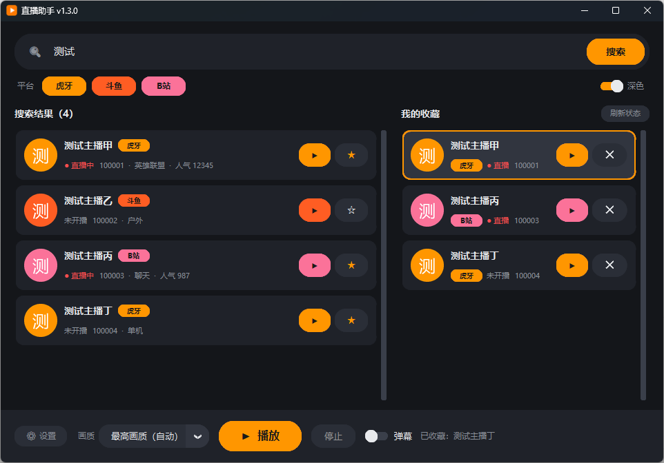
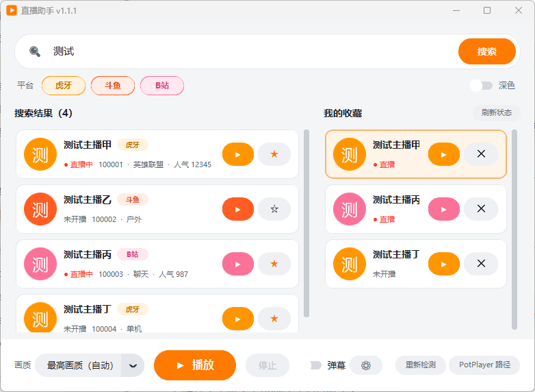
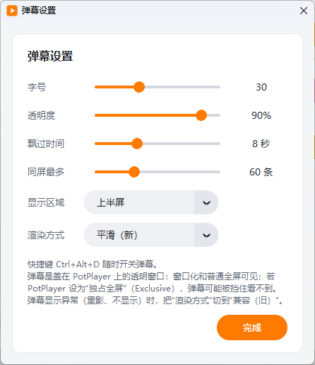

<div align="center">


# 直播助手 LiveHelper

**搜索主播 · 用 PotPlayer 看直播 · 自带弹幕悬浮层**

虎牙 / 斗鱼 / B 站，一个小工具搞定


 

</div>

> 个人练手和记录项目，仓库目前为私有。与各直播平台、PotPlayer 均无关联，仅用于个人观看公开直播。

## 📺 支持的平台

| 平台 | 搜索主播 | 房间号 / 链接 | 播放 | 画质 | 弹幕 |
|---|---|---|---|---|---|
| 🟠 虎牙 | ✅ | ✅ | ✅ | ✅ 真实档位 | ✅ |
| 🔴 斗鱼 | ✅（有风控，见下） | ✅ | ✅ | ✅ 同一流的虚标档位已合并 | ✅ |
| 🩷 B 站 | ✅ | ✅ | ✅ | 🔶 档位名未实测 | ✅ |

✅ = 在作者的电脑上用真实直播间实测过；🔶 = 部分验证。详细验证状态见 [docs/VERIFICATION.md](docs/VERIFICATION.md)。

## ✨ 功能

- 🔍 **搜索**：三个平台可分别勾选；也可以直接输入房间号或房间链接
- ▶️ **播放**：用 streamlink 管道播放进 PotPlayer（比只把一次性地址贴给播放器更稳，因为可以重新拉流）。**注意：斗鱼的流约每 5 分钟会被服务器切断，目前没有自动续播，需要重新点播放**
- 🎚️ **画质**：选中主播后查询该房间真实有的档位，显示成"原画（源码流）/ 超清 8 Mbps / 流畅 0.5 Mbps"这样的描述
- ⭐ **收藏**：常看的主播一键播放，启动时后台刷新是否在播
- 💬 **弹幕悬浮层**：透明、置顶、点击穿透，跟随 PotPlayer 窗口；播放栏有开关，全局快捷键 `Ctrl+Alt+D`；字号 / 透明度 / 飘过时间 / 显示区域 / 同屏上限可调
- 🧰 **PotPlayer 检测**：启动时自动查找；没找到时征得同意后用 winget 安装，也可手动指定路径
- 🌗 **浅色 / 深色主题**：切换时界面就地换色，不闪黑

<details>
<summary>📸 更多截图</summary>

 

</details>

## 📥 下载安装

在 [Releases](../../releases) 页面下载最新版本：

| 文件 | 说明 |
|---|---|
| `LiveHelper-Setup-vX.Y.Z.exe` | 安装包，双击安装，创建桌面快捷方式，可在"设置 → 应用"卸载 |
| `LiveHelper-vX.Y.Z-win64.zip` | 免安装文件夹版，解压后运行 `LiveHelper.exe` |
| `THIRD_PARTY_NOTICES.md` | 第三方组件的许可证声明（安装包和 zip 里也带有，另附 `LICENSE`） |
| `SHA256SUMS.txt` | 校验值，用 `Get-FileHash <文件> -Algorithm SHA256` 对比 |

**系统要求**：Windows（作者在 Windows 11 上开发和测试，Windows 10 未验证）；需要 [PotPlayer](https://potplayer.daum.net/)（没有的话程序会询问是否用 winget 安装）。

⚠️ 安装包**没有代码签名**，Windows 会提示"已保护你的电脑 / 未知发布者"，点"更多信息 → 仍要运行"即可；杀毒软件也可能误报。安装向导是英文（官方 Inno Setup 不带简体中文语言包）。

## 🚀 使用

1. 打开程序，输入主播名搜索（或输入房间号 / 链接），点卡片上的 ▶ 播放
2. 想看弹幕：打开底部的"弹幕"开关，或按 `Ctrl+Alt+D`；⚙ 里调整样式
3. 常看的主播点 ⭐ 收藏，下次直接在右侧"我的收藏"里点播放

## ⚠️ 已知限制

- 三个平台的**弹幕接口都是逆向得到的**，平台改动后可能失效（协议笔记见 [docs/DANMAKU.md](docs/DANMAKU.md)）
- PotPlayer **独占全屏**时弹幕可能看不到（普通全屏正常）
- **斗鱼的流约 5 分钟断流**（2026-10-27 实测：约 300 秒后服务器切断，streamlink 正常退出），目前没有自动续播，需要重新点播放；虎牙、B 站的断流情况未测
- 斗鱼搜索接口有风控，频繁搜索会提示"行为存在风险"，可改用房间号
- 弹幕里的 emoji 表情会被去掉；等空行超过 2 秒的弹幕会被丢弃
- 只做 Windows。高 DPI、多显示器、60Hz 显示器、别人的电脑、杀毒误报等未充分验证

## 🛠️ 从源码运行 / 构建

```bash
pip install customtkinter streamlink requests pillow websocket-client brotli psutil
python app.py
```

打包成安装包的步骤见 [docs/BUILD.md](docs/BUILD.md)。

## 🗂️ 目录

```
app.py            界面与主程序（customtkinter）
core.py           搜索、streamlink 解析与播放、画质、收藏、PotPlayer 检测
danmaku.py        三平台弹幕客户端 + 悬浮层 + 跟随窗口 + 全局快捷键
version.py        版本号（唯一定义处）
build.bat         PyInstaller 打包（见 docs/BUILD.md）
LiveHelper.iss    Inno Setup 安装包脚本
LICENSE           本项目许可证（AGPL-3.0）
THIRD_PARTY_NOTICES.md   第三方组件的版本、许可证与许可证全文
make_icon.py / make_version.py   生成图标 / exe 版本信息
test_*.py, bench_*.py, measure_motion.py   实测与性能脚本
docs/             构建说明、弹幕协议笔记、验证状态
screenshots/      界面截图（均为假数据）
```

## 📝 更新日志

见 [CHANGELOG.md](CHANGELOG.md)。版本号规则：加功能升第二位（1.1.0），修小问题升第三位（1.1.1）。

## 📄 许可证

本项目使用 **GNU AGPL-3.0** 许可证，详见 [LICENSE](LICENSE)。Copyright (C) 2026 Denvolatos。

- 可以自由使用、修改、分发；分发（或把修改版作为网络服务提供）时，必须同样以 AGPL-3.0 公开对应源码。
- 与各直播平台、PotPlayer 均无关联；PotPlayer 不随本软件分发。
- 设计上参考过开源项目「纯粹直播 Pure Live」（AGPL-3.0）的整体风格思路，**未复制其代码或图片素材**。

## 🧱 依赖

[streamlink](https://github.com/streamlink/streamlink)（BSD-2-Clause）、[customtkinter](https://github.com/TomSchimansky/CustomTkinter)（MIT）、requests、Pillow、websocket-client、brotli、psutil、PyInstaller、Inno Setup。PotPlayer 不随软件分发。完整的第三方组件清单、各自的许可证和许可证原文见 [THIRD_PARTY_NOTICES.md](THIRD_PARTY_NOTICES.md)（含 PyInstaller、pycountry、certifi 等需要特别说明的组件和尚未核对的清单）；安装后在安装目录里，也能找到这两个文件。
